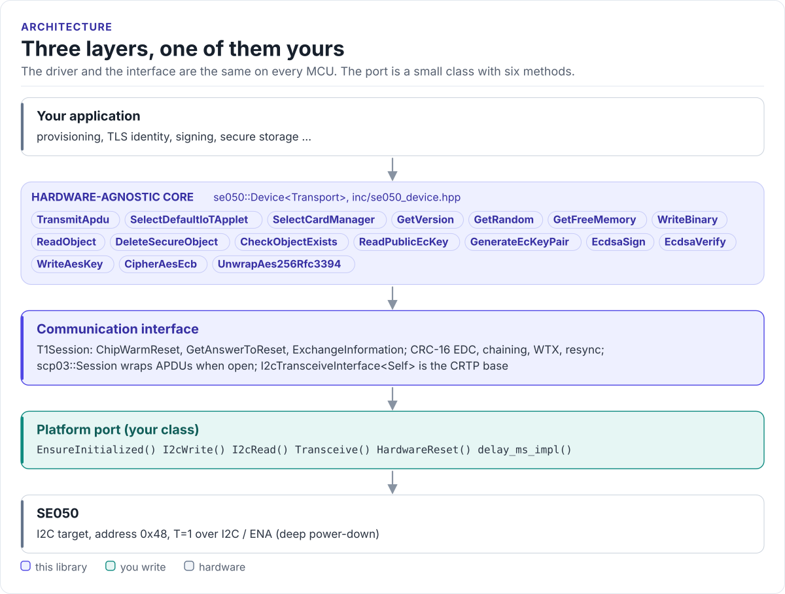

# SE050 Driver

A C++17 driver for the NXP EdgeLock SE050 secure element: T=1 over I2C, the IoT applet's commands for random
numbers, secure objects, on-chip EC keys and ECDSA, and an optional SCP03 channel, from any MCU with I2C.

[](https://github.com/hardfoc/hf-se050-driver/actions/workflows/ci-host-tests.yml)
[](https://github.com/hardfoc/hf-se050-driver/actions/workflows/esp32-examples-build-ci.yml)
[](https://hardfoc.github.io/hf-se050-driver/)
[](LICENSE)

**Documentation: <https://hardfoc.github.io/hf-se050-driver/>**

<!-- figure: driver-layers -->
<picture>
  <source media="(prefers-color-scheme: dark)" srcset="docs/diagrams/driver-layers.dark.svg">
  
</picture>
<!-- /figure -->

## In 30 seconds

Write a small port class for your MCU (I2C write, I2C read, a delay, optionally ENA;
[Porting](https://hardfoc.github.io/hf-se050-driver/latest/porting/)), then:

<!-- generated: quickstart-code -->
```cpp
#include "se050_device.hpp"

int read_32_random_bytes(MyI2c& i2c, std::uint8_t (&random)[32]) {
  se050::Device<MyI2c> se(i2c);

  // 1. Power-cycle through ENA (a no-op when ENA is not wired), then bring the T=1 link up.
  (void)se.HardwareReset();
  if (se.T1().ChipWarmReset(100) != se050::Error::Ok) {
    return -1; // wiring, pull-ups, supply or address
  }

  // 2. Select the IoT applet: the call succeeds and the applet answers SW 90 00.
  std::uint8_t rsp[32]{};
  std::size_t rsp_len = 0;
  if (se.SelectDefaultIoTApplet(rsp, sizeof(rsp), &rsp_len, 300) != se050::Error::Ok ||
      rsp_len < 2 || rsp[rsp_len - 2] != 0x90 || rsp[rsp_len - 1] != 0x00) {
    return -2;
  }

  // 3. Use it: 32 bytes from the SE050's random number generator.
  std::size_t n = 0;
  if (se.GetRandom(32, random, sizeof(random), &n, 300) != se050::Error::Ok || n != 32) {
    return -3;
  }
  return 0;
}
```
<!-- /generated -->

## What it does

- Brings up the T=1 over I2C link: CRC-16, chaining both ways, WTX and resynchronisation requests, ATR parsing.
- Selects the IoT applet and sends its commands: `GetVersion`, `GetRandom`, `GetFreeMemory`, binary objects,
  EC key generation, `EcdsaSign` / `EcdsaVerify`, AES keys, AES-ECB and RFC 3394 unwrap through the chip.
- Opens a GlobalPlatform SCP03 channel (C-MAC, C-ENC, R-MAC, R-ENC) with keys you provision; ships no keys.
- Builds any APDU you need with the APDU, TLV and command helpers.
- No heap, no exceptions, no RTOS, no virtual calls (the port is a CRTP class).

## Install

```bash
git submodule add https://github.com/hardfoc/hf-se050-driver.git external/hf-se050-driver
```

```cmake
add_subdirectory(external/hf-se050-driver)
target_link_libraries(my_app PRIVATE hf::se050)
```

ESP-IDF: use the component wrapper in [`examples/esp32/components/hf_se050`](examples/esp32/components/hf_se050/CMakeLists.txt).
Details: [Installation](https://hardfoc.github.io/hf-se050-driver/latest/installation/).

## Documentation

| | |
| --- | --- |
| [Quickstart](https://hardfoc.github.io/hf-se050-driver/latest/quickstart/) | Wire it, write the port, read random bytes |
| [Hardware](https://hardfoc.github.io/hf-se050-driver/latest/hardware/) | Pins, power modes, I2C settings, errata |
| [Security model](https://hardfoc.github.io/hf-se050-driver/latest/security/) | What is protected, key provisioning, SCP03, deployment flows |
| [API guide](https://hardfoc.github.io/hf-se050-driver/latest/api-guide/) | Bring-up, objects, keys and signatures, raw APDUs, errors |
| [Examples](https://hardfoc.github.io/hf-se050-driver/latest/examples/) | ESP32 applications |
| [API reference](https://hardfoc.github.io/hf-se050-driver/latest/api/) | Doxygen, every class and function |

The pages are in [`docs/`](docs/index.md). NXP's datasheets are linked from the
[Hardware](https://hardfoc.github.io/hf-se050-driver/latest/hardware/#reference-documents) page; they are not
redistributed here. Put local copies in `_local_reference/`, which git ignores.

## Tests

```bash
cmake -S . -B build-host -DHF_SE050_BUILD_TESTS=ON && cmake --build build-host && ctest --test-dir build-host
```

The host tests run the driver against a model of the SE050's T=1 target; the code on the documentation site is
compiled by the same build.

## License

GPL-3.0. See [LICENSE](LICENSE).
