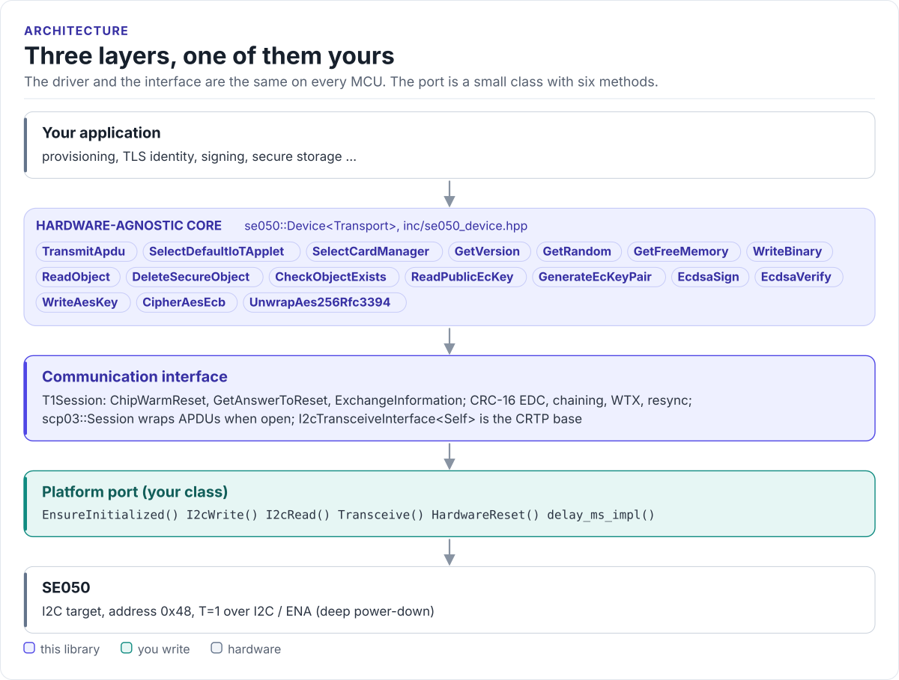
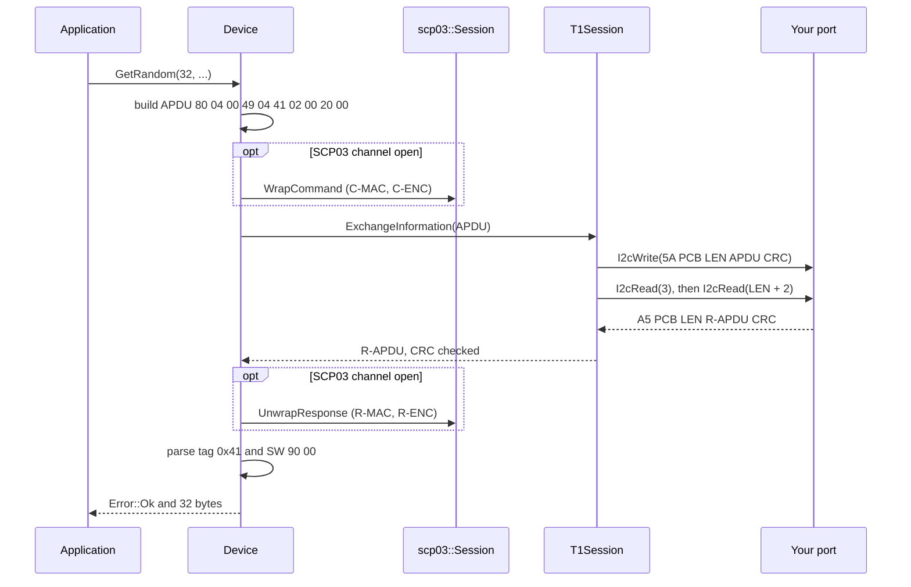

# Architecture

How the driver is put together: three layers, what each owns, and how one command reaches the chip.

<!-- figure: driver-layers -->
<picture>
  <source media="(prefers-color-scheme: dark)" srcset="diagrams/driver-layers.dark.svg">
  
</picture>
<!-- /figure -->

## The three layers

| Layer | Where | Depends on | You change it when |
| --- | --- | --- | --- |
| **Hardware-agnostic core**: `Device<Transport>`, its commands and the APDU, TLV and command builders | [`inc/se050_device.hpp`](../inc/se050_device.hpp), [`inc/se050_commands.hpp`](../inc/se050_commands.hpp), [`inc/se050_apdu.hpp`](../inc/se050_apdu.hpp) | The interface's methods only | Never, for a new board |
| **Communication interface**: `T1Session`, `scp03::Session`, the CRTP base `I2cTransceiveInterface` | [`inc/se050_t1_session.hpp`](../inc/se050_t1_session.hpp), [`inc/se050_scp03.hpp`](../inc/se050_scp03.hpp), [`inc/se050_i2c_transport_interface.hpp`](../inc/se050_i2c_transport_interface.hpp) | Six methods of your port | Never |
| **Platform port**: your class | Your project | Your SDK | Once per MCU or board ([Porting](porting.md)) |

Everything above the port is the same on ESP32, STM32, a Linux host or the unit-test model. That is how the
[host tests](testing.md) run the real T=1 and APDU code without a chip.

## How one command reaches the chip

## Design choices

- **CRTP, not virtual functions.** The port is a template parameter: `Device<MyI2c>`. The compiler sees your
  methods directly; there is no vtable, no RTTI and nothing to allocate. Code that must work with several port
  types takes the device as a template parameter too.
- **Caller-owned buffers.** Every command takes the output buffer and its capacity, and returns
  `Error::BufferTooSmall` rather than truncating. Working buffers are on the stack
  ([Configuration](configuration.md#buffers-and-stack)); the SCP03 wrap uses a buffer you bind once.
- **Errors are values.** Every call returns `se050::Error`; nothing throws. A status word other than `90 00`
  from a typed command becomes `Error::Protocol`; `TransmitApdu()` and the `Select*()` helpers return the raw
  R-APDU so you can read the status words yourself.
- **Plaintext unless you provision keys.** `TransmitApdu()` wraps only when `Scp03().IsOpen()`; opening the
  channel needs keys you pass at run time. A channel lost to a bad R-MAC is not replaced by plaintext behind your
  back: calls fail with `Error::Authentication` until you close or reopen it. See [Security model](security.md).
- **One owner.** The driver keeps T=1 sequence numbers and the SCP03 counter in the object. It is not thread-safe;
  give each SE050 one owner task or one mutex around every call.

## Source map

| Path | Contents |
| --- | --- |
| `inc/se050_device.hpp` | `Device<Transport>`: the application object and its commands |
| `inc/se050_t1_session.hpp` | `T1Session` and the `se050::t1` constants: blocks, chaining, WTX, resync |
| `inc/se050_crc.hpp` | The T=1 EDC (CRC-16) |
| `inc/se050_apdu.hpp`, `inc/se050_tlv.hpp` | ISO 7816-4 APDU builders and parsers, BER-TLV helpers |
| `inc/se050_commands.hpp` | IoT applet command builders and response parsers (`se050::cmd`) |
| `inc/se050_applet.hpp`, `inc/se050_atr.hpp` | `SELECT` builders and AIDs; the ATR / profile parser |
| `inc/se050_scp03.hpp`, `inc/se050_scp03_crypto.hpp` | GlobalPlatform SCP03 session, wrap and unwrap, `PUT KEY`; AES-128, CMAC, CBC, KDF on the host |
| `inc/se050_rfc3394.hpp` | RFC 3394 AES key wrap and unwrap over a block-cipher callback |
| `inc/se050_session.hpp`, `inc/se050_i2c_transport_interface.hpp` | Raw transport session; the CRTP interface |
| `inc/se050_types.hpp`, `inc/se050_driver.hpp` | `Error`, limits, default address; the umbrella header |
| `tests/` | Host unit tests and the compiled documentation snippets |
| `examples/esp32/` | ESP-IDF applications and the reference port |
