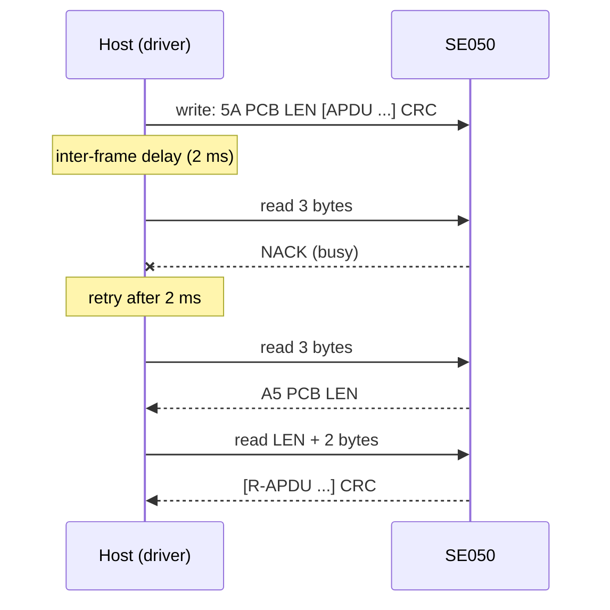

# Hardware

What to connect between your MCU and an SE050, with which bus settings, and the board-level details that decide
whether the chip answers.

All values here come from the [SE050 datasheet](https://www.nxp.com/docs/en/data-sheet/SE050-DATASHEET.pdf)
(Rev. 3.8, 18 October 2023) unless a row says otherwise. NXP does not allow its PDFs to be redistributed, so they
are linked, not stored in the repository.

## Pins (HX2QFN20)

| Pin | Name | Direction (chip) | Use with this driver |
| --- | --- | --- | --- |
| 9 | I2C_SDA | in / out, open drain | I2C target data to the host |
| 10 | I2C_SCL | in | I2C target clock from the host |
| 11 | ENA | in | Deep power-down while low; tie to VCC if unused. Referenced to VIN |
| 12 | VIN | supply | I2C pad supply; also the logic supply when deep power-down is used |
| 18 | VCC | supply | Logic supply; connect to VOUT (pin 15) to use deep power-down |
| 15 | VOUT | supply out | Feeds VCC in the deep power-down wiring; n.c. otherwise |
| 19 | VSS | ground | Ground. Connect the centre pad to ground too (thermal) |
| 3, 16 | IO1 / IO2 | in / out | ISO 7816 or the SE050's own I2C controller (SDA / SCL, 400 kHz); not used by the driver |
| 13, 14 | CLK, RST_N | in | ISO 7816 clock and reset; not used. RST_N has no effect when only I2C is enabled |
| 1, 17 | LB, LA | antenna | ISO 14443 contactless; connect to VSS if unused |
| 2, 4-8, 20 | n.c. | | Not connected |

## Reset and power modes

There is no reset pin for the I2C interface. A board resets the SE050 by power-cycling it, or with ENA:

| Mode | How it is entered | How it is left | Current (max) | State |
| --- | --- | --- | --- | --- |
| Deep power-down | ENA low | ENA high | < 5 µA | Lost: the chip boots again |
| Power-down | T=1 "end of APDU session" S-block | Falling edge on I2C_SDA | < 500 µA | Kept |

Deep power-down needs the chip supplied through VIN with VCC fed from VOUT. Wired that way, the port's
`HardwareReset()` can pulse ENA low and high to give a clean start; the reference port holds it low for 2 ms and
waits 10 ms after release. With VCC tied straight to the supply, use a load switch on the supply instead. The
driver does not send the end-of-session block, so it never enters power-down mode by itself.

!!! warning "Keep SDA and SCL high while the SE050 boots"
    At power-up the SE050 picks its interface: it uses I2C only when I2C_SDA and I2C_SCL are both high (its weak
    internal pull-ups are on). A host that holds the bus low during the SE050's boot leaves it waiting for
    another interface until the next reset.

## Bus settings

| Setting | Value |
| --- | --- |
| Role | I2C target; the host is the controller |
| Address | 0x48 (7-bit, `1001000`), `se050::kDefaultI2cAddress7` |
| Speed | Up to 3.4 MHz (high-speed mode) with clock stretching; 1 MHz without |
| Clock stretching | On by default in configurations A, B, C, D, F, above 600 kHz; off by default on SE050E |
| Pull-ups | External, to VIN, sized for the bus speed and capacitance |
| Protocol | Smartcard T=1 over I2C, NXP UM11225 ([T=1 over I2C](t1-over-i2c.md)) |

A host that cannot handle clock stretching stays below 600 kHz on a configuration with stretching on, or uses a
configuration with stretching off, which runs up to 1 MHz. The ESP32 examples run at 100 kHz, which every
configuration supports; start there for bring-up.

## How an exchange looks on the bus

The host writes one complete T=1 block, waits the inter-frame delay, then reads the answer in two parts: the
three-byte prologue (NAD, PCB, LEN), then LEN bytes of information and the two-byte CRC. While the SE050 is still
working it NACKs its address, and the driver retries the read.

A long operation (key generation, RSA) may answer with an S(WTX) request instead; the driver answers it and keeps
reading. [T=1 over I2C](t1-over-i2c.md) has the block types and the timing settings.

## Power

| Supply | Range | Notes |
| --- | --- | --- |
| VIN, VCC | 1.62 V to 3.6 V, 1.8 V typical | Characterised range. 6 V absolute maximum; above 3.6 V the deep power-down current is not guaranteed |
| Digital inputs | −0.3 V to VIN + 0.3 V | SDA, SCL and ENA are referenced to VIN |

| Temperature grade (part number digit) | Ambient range |
| --- | --- |
| 1 (standard) | −25 °C to 85 °C |
| 2 (extended) | −40 °C to 105 °C |

Run the MCU's I/O at the SE050's VIN, or add a level shifter: the SE050 is not 5 V tolerant within its operating
range.

## Errata that affect the host

From the [SE050 errata sheet](https://www.nxp.com/docs/en/errata/SE050_Erratasheet.pdf) (Rev. 1.0, 14 October
2020):

| Erratum | What happens | What the driver and your port do |
| --- | --- | --- |
| I2C.1: lock-up on an erroneous APDU sequence | A new command written before the previous response was read in full can make the SE050 stretch SCL permanently (clock stretching on) until it is power-cycled. A host that resets mid-exchange causes exactly this | The driver always reads a response to the end. After a host reset, power-cycle the SE050 (ENA or supply) before the first command: wire ENA and call `HardwareReset()` first |
| I2C.2: empty frame | An acknowledged address-only frame (START, address, STOP) makes the SE050 stretch the clock permanently | The driver never sends one, and `Session::TransceiveRaw()` rejects a zero-length write. Do not run an I2C bus scan with the SE050 on the bus |
| I2C.3: lines low at start-up | SDA or SCL low during interface detection triggers a security reset after about 1 s; repeated events lock the chip | Keep the bus idle high, with pull-ups, whenever the SE050 is powered |
| I2C.4: edge timing | SCL must change before SDA with a margin: data hold time (50 % to 50 %) at least 8 ns falling, 24 ns rising in fast mode | Check your MCU's I2C hold-time setting; most controllers meet it by default |
| JOS.2: SCP03 counter | Inside a platform SCP03 session, a command without command data does not advance the SE050's encryption counter, and the next command fails | See [Security model](security.md#protect-the-bus-with-scp03): send commands with data while the channel is open |

!!! danger "One host per SE050, one command at a time"
    I2C.1 is why the driver is not thread-safe and must not be shared between tasks without a lock: two commands
    interleaved on the bus can hang it until a power cycle.

## Configurations

SE050 is a family of pin-compatible configurations (SE050A, B, C, D, E, F and their variants) that differ in
enabled features, pre-provisioned credentials, clock-stretching default and certification. NXP's
[configurations note AN12436](https://www.nxp.com/docs/en/application-note/AN12436.pdf) lists them; check the one
on your board before you choose a bus speed, an applet AID or object identifiers. The default AID in
`se050::applet::kDefaultIoTAppletAid` is the Plug & Trust IoT applet's; confirm it for your configuration.

## Evaluation and example boards

The [ESP32 examples](examples.md) run on an ESP32-S3 with the SE050 on I2C port 0:

| Signal | ESP32-S3 GPIO | Setting in `Se050EspI2cConfig` |
| --- | --- | --- |
| SDA | 47 | `sda` |
| SCL | 48 | `scl` |
| ENA (optional) | not connected | `reset_gpio` (`GPIO_NUM_NC`) |
| Bus speed | 100 kHz | `freq_hz` |
| Address | 0x48 | `device_address7` |

The reference port turns on the ESP32's internal pull-ups, which are weak; add external pull-ups for anything
but a short bench connection. The configuration is in
[`hf_se050_esp_i2c.hpp`](../examples/esp32/main/include/hf_se050_esp_i2c.hpp).

## Reference documents

| Document | What it is for |
| --- | --- |
| [SE050 datasheet](https://www.nxp.com/docs/en/data-sheet/SE050-DATASHEET.pdf) | Pins, electrical limits, power modes, I2C speeds |
| UM11225, SE05x T=1 over I2C (from NXP's [SE050 documentation](https://www.nxp.com/products/SE050)) | Block format, S-blocks, timing: what `T1Session` implements |
| [SE050 errata sheet](https://www.nxp.com/docs/en/errata/SE050_Erratasheet.pdf) | I2C and SCP03 problems the host must avoid |
| [AN12413, APDU specification](https://www.nxp.com/docs/en/application-note/AN12413.pdf) | Every IoT applet command, tag and status word the driver uses |
| [AN12436, configurations](https://www.nxp.com/docs/en/application-note/AN12436.pdf) | Which features, keys and defaults each part number has |
| [AN12514, use and security guidelines](https://www.nxp.com/docs/en/application-note/AN12514.pdf) | NXP's rules for using the SE050 securely |
