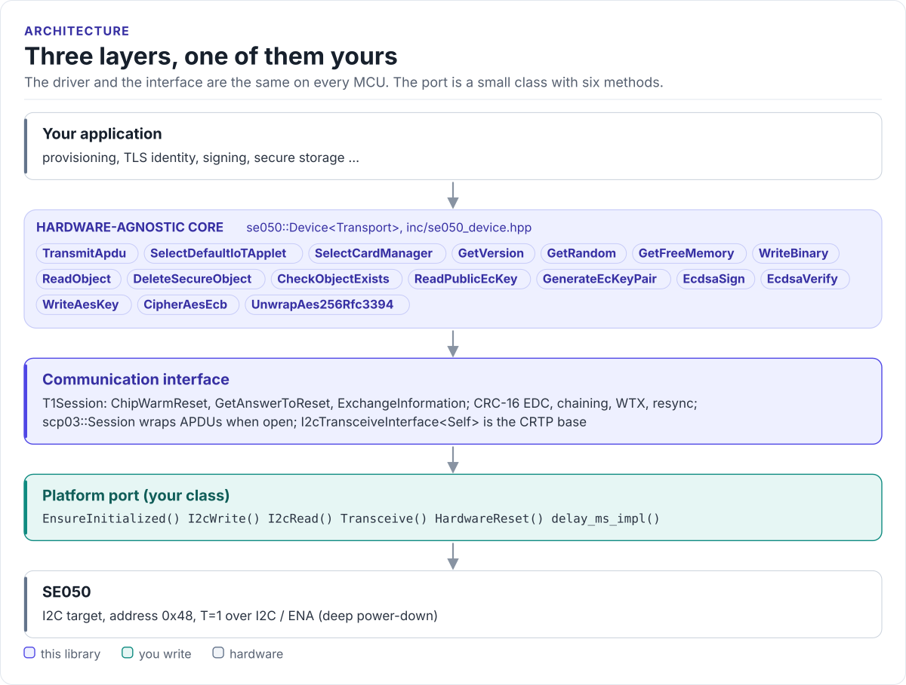

# Porting

Run the driver on a new MCU by writing one class: the I2C interface.

The driver never calls your SDK directly. It calls six methods on a class you derive from
`se050::I2cTransceiveInterface<Self>` (in
[`inc/se050_i2c_transport_interface.hpp`](../inc/se050_i2c_transport_interface.hpp)). The base class uses CRTP:
the calls are resolved at compile time, so there are no virtual functions, no vtable and nothing to allocate.

<!-- figure: driver-layers -->
<picture>
  <source media="(prefers-color-scheme: dark)" srcset="diagrams/driver-layers.dark.svg">
  
</picture>
<!-- /figure -->

## What you implement

| Method | Contract |
| --- | --- |
| `bool EnsureInitialized()` | Return `true` once the bus is ready. Called before every exchange: make it cheap after the first call |
| `Error I2cWrite(tx, tx_len, timeout_ms)` | One I2C write of exactly `tx_len` bytes to the SE050's address: START, address + W, the bytes, STOP. `tx_len` is never 0 |
| `Error I2cRead(rx, rx_len, timeout_ms)` | One I2C read of exactly `rx_len` bytes. Return `Transport` or `Timeout` on a NACK: the driver retries those two |
| `Error Transceive(tx, tx_len, rx, rx_cap, rx_len_out, timeout_ms)` | A write then a read, for `Device::TransceiveRaw()` during bring-up only; T=1 does not use it |
| `Error HardwareReset()` | Power-cycle the SE050 (ENA low, then high) if your board can; return `Ok` if it cannot |
| `void delay_ms_impl(ms)` | Block for at least `ms` milliseconds (an RTOS delay is fine) |

All methods are `noexcept`. Return `Error::Ok` on success; any other value aborts the exchange (after retries, for
reads).

## The port

```cpp title="my_i2c.hpp"
--8<-- "tests/docs/my_i2c.hpp:port"
```

Rules the transfers must follow:

- **One block, one write.** The SE050 expects the whole T=1 block in one I2C transaction. Never split it, never
  add a register address in front of it.
- **No zero-length writes, no bus scans.** An address-only frame can hang the SE050 (erratum I2C.2, see
  [Hardware](hardware.md#errata-that-affect-the-host)).
- **Report NACKs as `Transport` or `Timeout`.** The SE050 NACKs reads while it works; the driver polls through
  them. Other values are not retried.
- **No delays of your own.** The driver waits the inter-frame delay and the retry delay through `delay_ms_impl()`.
- **Pull-ups and idle-high lines** before the SE050 powers up ([Hardware](hardware.md#reset-and-power-modes)).

## Reference implementation

The ESP32 examples use [`hf_se050_esp_i2c.hpp`](../examples/esp32/main/include/hf_se050_esp_i2c.hpp): an ESP-IDF
v5 `i2c_master` port with an optional ENA GPIO and FreeRTOS delays. Start from it for any ESP-IDF target.

On HardFOC boards the SE050 is used through `Se050Handler` in [hf-core](https://github.com/hardfoc/hf-core): it
implements this interface over the HAL's `BaseI2c` and an optional `BaseGpio` for the reset line (wire it to ENA),
adds a mutex and owns the `Device`. Build it with `HF_CORE_ENABLE_SE050`.

## Check your port

1. Build it: the port on this page is compiled by the host CI from [`tests/docs/`](../tests/docs/my_i2c.hpp), with
   every driver class instantiated over it.
2. Run `ChipWarmReset()` and `GetAnswerToReset()`: both succeeding proves writes, reads, NACK handling and the CRC.
3. `SelectDefaultIoTApplet()` answering `90 00`, then `GetRandom(32, ...)`: APDUs work end to end.
4. Run the `se050_smoke_example` logic on your board: version, random and free memory.

## Threads

The driver is not thread-safe, and the SE050 must not see a second command before the first response has been
read (erratum I2C.1). Give each SE050 one owner task, or guard every call on a device object with one mutex.
Other devices on the same I2C bus are fine as long as your bus driver serialises transfers.
