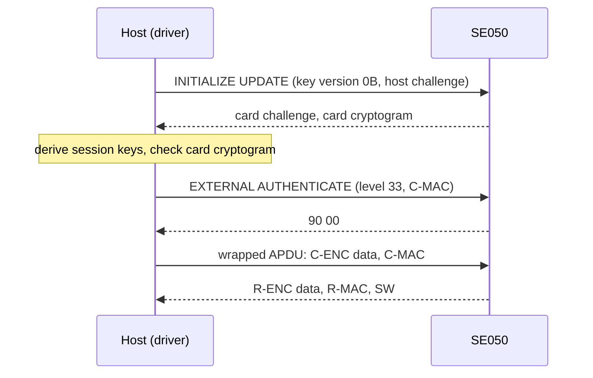
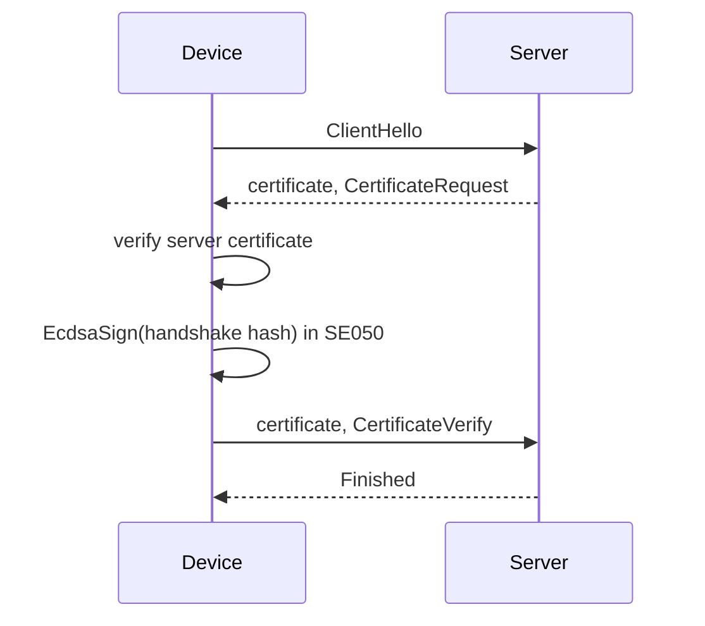

# Security model

What the SE050 and this driver protect, what they do not, how to provision keys, and how the common device
security flows map onto the driver's calls.

This page is engineering guidance, not a certification argument. For a product, read NXP's
[use and security guidelines AN12514](https://www.nxp.com/docs/en/application-note/AN12514.pdf) and your
configuration's entry in [AN12436](https://www.nxp.com/docs/en/application-note/AN12436.pdf) alongside it.

## What the SE050 gives you

- **Keys that do not leave the chip.** `GenerateEcKeyPair()` creates the private key inside the SE050. The host
  can read the public key and ask for signatures; it cannot read the private key.
- **Signing and verification on chip.** `EcdsaSign()` and `EcdsaVerify()` take a digest you computed; the
  signature is ASN.1 DER.
- **Secure storage.** Binary objects and AES keys in up to 50 kB of user flash, addressed by a 4-byte object
  identifier.
- **A true random number generator.** `GetRandom()`; NIST SP800-90B TRNG and SP800-90A DRBG.
- **A certified environment.** Common Criteria EAL 6+ for hardware and OS (datasheet); FIPS 140-2 level 3 only on
  specific product types.
- **Bus protection.** GlobalPlatform SCP03 between host and chip, which this driver implements.

## What this driver does, and does not

| Area | The driver | Not in the driver (today) |
| --- | --- | --- |
| Transport | T=1 over I2C with CRC; plaintext APDUs by default | |
| Platform SCP03 | `INITIALIZE UPDATE` / `EXTERNAL AUTHENTICATE`, security level `0x33` (C-MAC, C-ENC, R-MAC, R-ENC); wrap and unwrap of short APDUs; `BuildPutKey()` to replace the key set | Extended-length APDUs inside the channel; making SCP03 mandatory on the chip (`SetPlatformSCPRequest`) |
| Applet sessions | | UserID, AESKey or ECKey authenticated sessions; object policies |
| Keys | EC key generation (NIST curves), AES key write, ECDSA sign / verify, AES-ECB, RFC 3394 unwrap through the chip | RSA, ECDH, attested reads, certificate handling |
| Key material in the code | None. `OpenSecureChannel()` returns `Error::NotSupported` without keys | |

The commands go to the applet in plaintext unless you open an SCP03 channel. On a board where nobody can reach the
I2C lines that may be acceptable; on most products it is not.

## Threats and what stops them

| Attacker can | Without SCP03 | With SCP03 open |
| --- | --- | --- |
| Read firmware from the MCU | No SE050 private keys in it. Any SCP03 host keys on the MCU are exposed: protect them with flash encryption | Same |
| Listen on I2C | Sees every APDU and response: public keys, signatures, data you write or read, AES keys you write | Sees encrypted, MACed APDUs |
| Inject or change I2C traffic | Can forge any response, including "signature valid" from `EcdsaVerify()` and data from `ReadObject()` | Tampered responses fail the R-MAC and close the channel, with one exception below |
| Take the SE050 to another board | Can use its keys there: they are not bound to your MCU | Needs the SCP03 keys too |
| Extract keys from the SE050 by attacking the chip | Out of scope for the driver: the chip's certification covers it | Same |

!!! warning "Responses shorter than 10 bytes are not MAC-checked"
    `scp03::UnwrapResponse()` passes a response of fewer than 10 bytes through as status words without checking a
    MAC. GlobalPlatform allows error status words without a MAC, but the driver accepts a bare `90 00` the same
    way, so an attacker on the bus can fake success for commands that return only a status
    (`WriteBinary()`, `DeleteSecureObject()`, `GenerateEcKeyPair()`, `WriteAesKey()`). Commands that return data
    (`ReadObject()`, `EcdsaVerify()`, `GetRandom()`) are not affected: their data must be inside a MACed response.
    Read back what you wrote when it matters.

Verify firmware-update signatures on the MCU, with a public key in its protected storage, rather than trusting
`EcdsaVerify()` over a plaintext bus.

## Provision keys

### Platform SCP03 keys

Each SE050 configuration leaves the factory with a platform SCP03 key set (ENC, MAC, DEK) that is the same for
every part of that configuration, and NXP documents it in AN12436. Treat those keys as public. In provisioning:

1. Open an SCP03 channel with the configuration's factory keys, read from your provisioning tool, never from the
   firmware source.
2. `SelectCardManager()`, then send `scp03::BuildPutKey()` with new keys for key version `0x0B`: unique per device,
   or at least per batch, generated by your provisioning station.
3. Check the response against the key check values `BuildPutKey()` returns.
4. Store the new ENC and MAC keys on the MCU in protected storage (on ESP32: flash encryption and encrypted NVS,
   or keys derived from an eFuse-protected secret). Store the DEK only where you will rotate keys again.
5. Record the device and key version in your backend; destroy the station's copy when policy allows.

At run time the firmware loads the keys, opens the channel and wipes its copies; the
[API guide](api-guide.md#open-an-scp03-channel) has the code. The driver never contains key bytes, and its tests
use only published test vectors (RFC 3394). Do not paste real keys into issues, logs or examples.

### Device identity

1. Choose an object identifier for the identity key. The applet reserves some identifiers for its own
   authentication objects (AN12413, section 3.2.5) and trust-provisioned configurations add their own objects:
   check your configuration before you pick one.
2. `CheckObjectExists()`; if it does not exist, `GenerateEcKeyPair(id, EcCurve::NistP256)`.
3. `ReadPublicEcKey()` and send the public key to your backend, with a signature over a backend challenge so the
   backend knows the key is live (`EcdsaSign()`).
4. The backend binds the public key to the device's serial number, or issues a certificate for it; write the
   certificate back with `WriteBinary()` if the device must present it.

Some SE050 configurations carry NXP trust-provisioned attestation keys and certificates (AN12436). The driver has
no attested-read command; use backend registration as above, or add the command from AN12413.

### Reserved objects

The applet's reserved authentication objects (transport lock, factory reset, platform SCP requirement and others)
are described in AN12413, section 3.2.5. The driver does not use them. Leave them alone unless your provisioning
procedure needs them.

## Protect the bus with SCP03

- The host challenge must be fresh random bytes for every channel; take them from the MCU's TRNG (or from the
  SE050's `GetRandom()` before the channel opens, accepting that those bytes crossed the bus in plaintext).
- Bind the wrap buffer once with `BindScp03WrapScratch()` (at least `scp03::kWrapScratchBytes`, 320 bytes).
- Inside the channel the driver wraps short APDUs only: up to 255 bytes of command data including padding and MAC.
- Erratum JOS.2: the SE050 does not advance its encryption counter for a command without command data, so the
  next command fails. `GetVersion()` sends no data; call it before opening the channel.
- A response that fails its R-MAC closes the channel (`IsOpen()` becomes `false`): treat that as an attack or a
  wiring fault, not as a retry case.
- `Close()` marks the channel closed; it does not wipe the session keys held in the device object.

## Deployment flows

### TLS with an SE050-held identity

For Ethernet or Wi-Fi, use TLS (TCP) or DTLS (UDP) with the device key in the SE050 as the client identity, and
verify the server: reject invalid or expired certificates, pin the service identity, never disable verification
in development builds. The private-key operation of the handshake goes to `EcdsaSign()`; the
`se050_aws_iot_lifecycle` [example](examples.md) plugs it into mbedTLS.

### Firmware updates

1. Sign the image or its manifest offline, with a key that never touches the device.
2. The device downloads over TLS, verifies the signature before installing and refuses a lower version
   (anti-rollback), then boots only a verified image.
3. Keep the vendor public key where an attacker cannot replace it. Written once into the SE050 at provisioning, it
   is protected against replacement; verify on the MCU when the bus is plaintext, or on the SE050 only inside an
   SCP03 channel.

### Messages without TLS

When a link cannot carry TLS (CAN, UART, raw radio), sign or encrypt each message yourself:

| Need | Do |
| --- | --- |
| Authenticity and integrity | Sign `counter ‖ nonce ‖ payload` with the SE050 key (`EcdsaSign()`), or use AES-GCM with a shared key |
| Confidentiality | AES-GCM or ChaCha20-Poly1305, with routing data and the counter as additional data |
| Freshness | A counter per sender, and a replay window at the receiver |
| Never | Reuse a nonce with the same key; accept a message whose tag or signature fails; use ECB or unauthenticated CBC |

The `se050_secure_board_comms_example` [example](examples.md) shows the signed variant between two boards.

## Production checklist

- Factory SCP03 keys replaced; host keys in protected storage; SCP03 open before any sensitive command.
- Identity key generated on chip, public key registered; no private key ever exported.
- Every message and update bound to freshness (counter, nonce or version).
- Key rotation and revocation handled by the backend.
- Security events logged: failed signature, R-MAC failure, rollback attempt, stale counter.
- Debug builds cannot skip certificate or signature checks.
- One owner task per SE050 (erratum I2C.1); ENA wired so the host can power-cycle the chip after its own reset.
