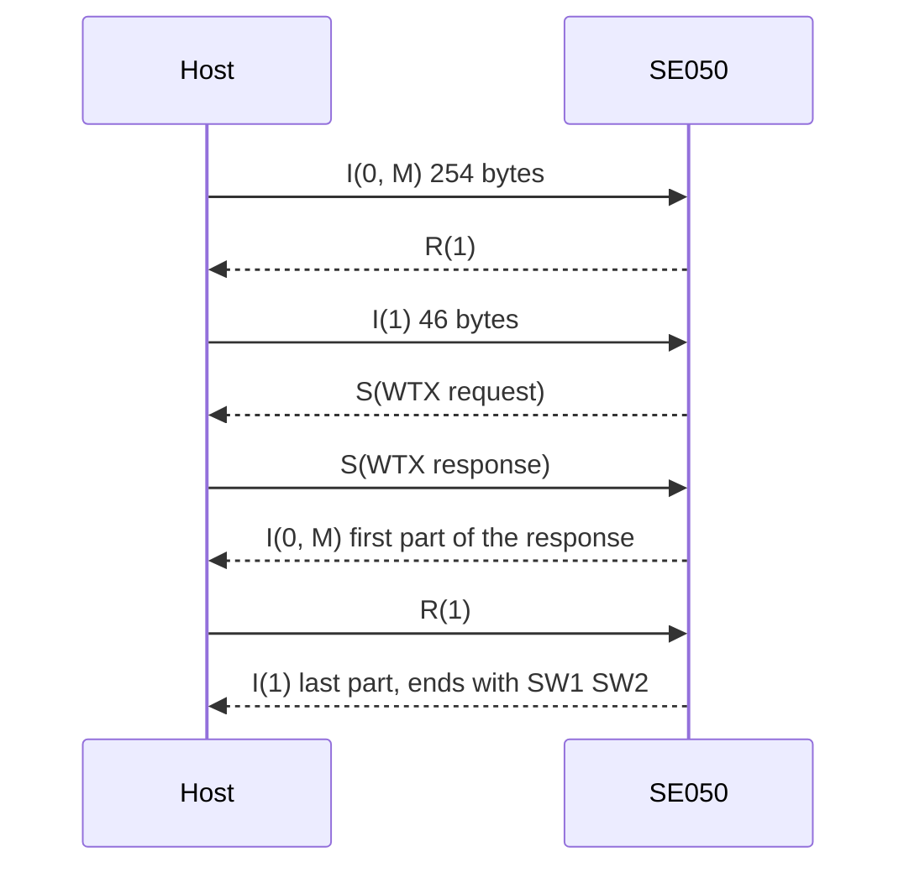

# T=1 over I2C

How the driver carries APDUs to the SE050: the ISO/IEC 7816-3 T=1 block protocol, as NXP adapts it to I2C in
UM11225, and what `T1Session` does at each step.

## Blocks

Every exchange is a sequence of blocks. The host writes a block in one I2C write; the SE050's answer is read in
two I2C reads, the prologue first.

| Field | Bytes | Content |
| --- | --- | --- |
| NAD | 1 | `0x5A` host to SE050, `0xA5` SE050 to host |
| PCB | 1 | Block type and sequence bits, below |
| LEN | 1 | Length of INF, 0 to 254 |
| INF | LEN | APDU bytes, or an S-block's parameter |
| EDC | 2 | CRC-16 over NAD to INF, LSB first |

The constants are `t1::kNadHostToSe`, `t1::kNadSeToHost` and `t1::kMaxInformationField`.

The EDC is CRC-16/X-25: reflected polynomial `0x8408`, initial value `0xFFFF`, final XOR `0xFFFF` (check value
`0x906E` for `"123456789"`, tested in [`tests/test_t1.cpp`](../tests/test_t1.cpp)). A block that fails the check
is `Error::Crc`.

## Block types

| PCB | Block and what the driver does with it |
| --- | --- |
| `0x00`, `0x40` | I-block, N(S) = 0 or 1; `+0x20` sets M (more follows). APDU data both ways: `t1::IBlockPcb(ns, more)` |
| `0x80`, `0x90` | R-block, N(R) = 0 or 1 (error code in the low bits). Acknowledges a chained block: `t1::RBlockAckPcb(nr)` |
| `0xC0` / `0xE0` | S(RESYNCH) request / response. The SE050 asks; the driver resets its sequence numbers and answers |
| `0xC3` / `0xE3` | S(WTX) request / response. The SE050 needs more time; the driver echoes the INF and keeps waiting |
| `0xC6` / `0xE6` | S-block reset request / response. `ChipWarmReset()`: resets the T=1 state on both sides |
| `0xC7` / `0xE7` | S(GET ATR) request / response. `GetAnswerToReset()` returns the profile bytes |

## Sequence numbers and chaining

The host and the SE050 each keep a one-bit send sequence number, N(S), which alternates with every I-block they
send. `T1Session` keeps both and checks the SE050's: an I-block with the wrong N(S) is `Error::Sequence`.

An APDU longer than 254 bytes is split. Every block but the last has the M bit set, and the SE050 acknowledges each
with an R-block before the host sends the next. Long responses come back the same way, and the driver
acknowledges each chained block with an R-block carrying N(R).

After any error in an exchange the two sides may disagree about the sequence numbers. Call
`ResetSequenceState()` and `ChipWarmReset()` before the next command ([API guide](api-guide.md#handle-errors)).

## Timing

| Setting | Default | Meaning |
| --- | --- | --- |
| `SetInterFrameDelayMs()` | 2 ms | Wait after every block write before the first read |
| `SetReadRetries()` | 6 | Re-reads after a read that returned `Transport` or `Timeout` (the SE050 NACKs while busy) |
| `SetReadRetryDelayMs()` | 2 ms | Wait between those re-reads |
| `SetMaxWtxRequests()` | 8 | S(WTX) requests accepted in one exchange before giving up with `Error::Protocol` |
| `timeout_ms` argument | per call | Passed to every `I2cWrite()` / `I2cRead()` of the exchange |

With the defaults, a read gives up after 7 attempts, 12 ms of waiting plus the I2C time. Commands that take longer
(EC key generation, RSA) are covered by the SE050's WTX requests, not by the retries. [Configuration](configuration.md)
shows how to change the settings.

## The ATR

`GetAnswerToReset()` returns the SE050's profile bytes; `se050::atr::Parse()` decodes them into
`atr::Profile`: protocol version, vendor ID, block waiting time (`bwt`), IFSC, maximum I2C clock (`max_i2c_khz`),
minimum polling time, guard time (`segt_us`), wake-up time and the historical bytes. The driver does not adapt to
the profile: it sends up to 254 bytes per block and uses the timing settings above. Log the profile at bring-up
and set the timing from it if your configuration differs.

## What the driver does not use

The driver implements the blocks above. It does not send S(IFS) to change the block size, S(ABORT), the
end-of-APDU-session request that puts the SE050 into power-down mode, or the interface soft reset.
